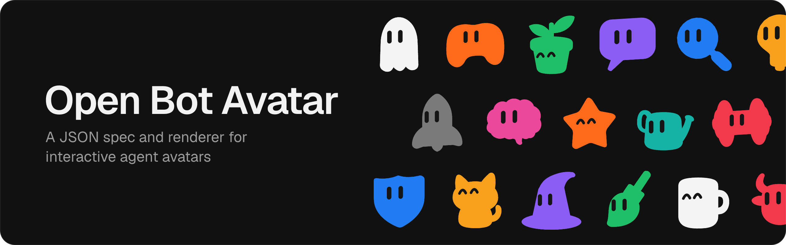

<p></p>

A JSON spec and renderer for interactive agent avatars.

- Spec: one SVG path and where the eyes sit ([contract](docs/avatar-contract.md)).
- Renderer: the `open-bot-avatar` package, no dependencies.
- [Editor](https://dominikscholz.github.io/open-bot-avatar/): pick, color, generate and import avatars.

Open source, MIT licensed. [Docs](https://dominikscholz.github.io/open-bot-avatar/#/docs).

## Make an avatar

In the [editor](https://dominikscholz.github.io/open-bot-avatar/), describe it under Generate, send the prompt to any chat model or agent, and paste the JSON it returns into Import. The prompt is [system-prompt.md](skills/generate-avatar/references/system-prompt.md); agents with skills can use the [generate-avatar skill](skills/generate-avatar/SKILL.md).

To add one to the gallery, open a pull request with its JSON in [`gallery/`](gallery).

## Definition

One SVG path in a `0 0 100 100` box, and the eyes.

```json
{
  "version": 1,
  "id": "box",
  "name": "Box",
  "body": { "path": "M20 20 H80 V80 H20 Z" },
  "eyes": { "x": 50, "y": 46, "spacing": 15, "scale": 1 }
}
```

`x`, `y`: the eyes' center; `spacing`: the distance between them; `scale`: their size. Check definitions you didn't write with `validateAvatar`, which returns `{ ok: true, value }` or `{ ok: false, errors }`. The rules are in the [contract](docs/avatar-contract.md).

## How it renders

The volume is inferred from the outline as stacked cross-sections. Live avatars project them and paint each frame to one canvas; stills are projected into one SVG. A CSS 3D scene with one SVG per cross-section is available as `renderer: "scene"`.

## Install

```sh
pnpm add open-bot-avatar
```

## Mount an avatar

`mountAvatar` fills a square element.

```ts
import { getExample } from "open-bot-avatar";
import { mountAvatar } from "open-bot-avatar/dom";

const avatar = mountAvatar(document.querySelector("#bot")!, {
  definition: getExample("mug")!,
  color: "#ff6a1a",
  followPointer: true,
});

avatar.update({ state: "working", mood: "happy" }); // any subset of the options
avatar.destroy();
```

| Option | |
| --- | --- |
| `definition` | The avatar. Required. |
| `color`, `eyeColor` | `#rgb` or `#rrggbb`. Default: `#ff6a1a`, `#151515`. |
| `state` | What the bot is doing: `"idle"` (default), `"thinking"`, `"working"`, `"waiting"`, `"blocked"` or `"done"`. |
| `mood` | How it feels: `"neutral"` (default), `"happy"`, `"surprised"`, `"angry"` or `"sad"`. It shapes the eyes on any state. |
| `followPointer` | Look at the mouse or finger. Default: `false`. |
| `lookAt` | A fixed look direction, `{ x, y }` from -1 to 1. Wins over the pointer. |
| `holdGaze` | Keep looking where it looks now. Default: `false`. |
| `view` | Extra rotation, `{ yaw, pitch }` in radians. |
| `depth` | Volume, 0 (flat) to 14. Default: 6. |
| `reducedMotion` | `true`, `false` or `"system"` (default). |
| `still` | One static SVG, no animation. Default: `false`. |
| `label` | Accessible name. Default: the definition's name; `""` for decorative. |

## SVG

`renderAvatarSvg` returns an SVG string; `avatarFrame` returns the same frame as data, for drawing it yourself. Neither needs a DOM.

```ts
import { avatarFrame, renderAvatarSvg, validateAvatar } from "open-bot-avatar";

const result = validateAvatar(JSON.parse(json));
if (result.ok) {
  const svg = renderAvatarSvg(result.value, { color: "#1fbf68", size: 256 });
  const frame = avatarFrame(result.value, { color: "#1fbf68" });
}
```

Both also take `time` (seconds), `motion` (the mood) and `gaze`.

## React

There's no React package; copy this component. Other frameworks work the same way.

```tsx
import { useEffect, useRef } from "react";
import { mountAvatar, type AvatarOptions, type MountedAvatar } from "open-bot-avatar/dom";

export function BotAvatar({ size = 96, ...options }: AvatarOptions & { size?: number }) {
  const host = useRef<HTMLDivElement>(null);
  const avatar = useRef<MountedAvatar | null>(null);
  useEffect(() => {
    avatar.current = mountAvatar(host.current!, options);
    return () => avatar.current?.destroy();
  }, []);
  useEffect(() => avatar.current?.update(options));
  return <div ref={host} style={{ width: size, aspectRatio: "1" }} />;
}
```

## Repository layout

```text
packages/core/   npm package: engine and browser mount
apps/site/       editor and documentation (Vite + React)
gallery/         community avatar definitions
skills/          design prompt and generation skill
docs/            definition contract
```

## Development

```sh
pnpm install
pnpm dev          # the site, with the package from source
pnpm test         # Vitest: engine, DOM mount, editor and gallery checks
pnpm typecheck
pnpm build        # the package to dist/, the site to apps/site/dist/
pnpm check        # typecheck, tests and build, in sequence
node packages/core/scripts/avatar-validate.ts --strict my-avatar.json --svg my-avatar.svg
```

Needs Node 22.18+ and pnpm.

## License

[MIT](LICENSE)
